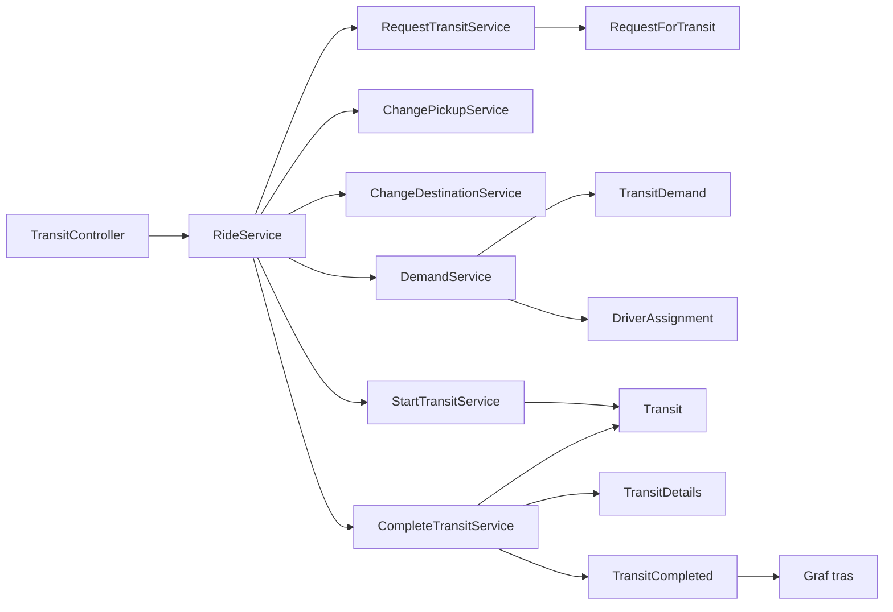

# Jak analizować ukończony kurs

Repozytorium zawiera adaptację kodu i testów dla wszystkich 70 tagów z
[cabs-java](https://github.com/legacyfighter/cabs-java), z zachowaniem bazy TypeScript
oraz wcześniejszej migracji użytkownika do MikroORM. Materiał został odtworzony na podstawie
publicznej historii kodu i agendy dostępnego kursu; nie jest transkrypcją nagrań.

## Punkty start/stop

Dla zwykłego etapu, np. `vo-license`, istnieją trzy tagi:

| Tag | Znaczenie |
| --- | --- |
| `course/vo-license/start` | Commit przed zmianą |
| `vo-license` | Odpowiednik nazwanego etapu Java |
| `course/vo-license/stop` | Ten sam commit co `vo-license` |

```sh
npm run course:list
npm run course:diff -- vo-license
npm run course:check
git switch --detach vo-license
npm ci
```

`course:check` sprawdza obecność tagów, zgodność końców i niepuste różnice w plikach.
Każdy commit implementacyjny zawiera SHA odpowiadającego etapu Java.
[Mapa etapów](course-map.md) pozwala przejść bezpośrednio do wersji źródłowej.

Wyjątki są jawne:

- `start` pozostaje oryginalnym historycznym tagiem TypeORM. Nie został przestawiony.
- `course/start` jest bazą po aktualizacji NestJS i MikroORM, z wcześniejszą pracą użytkownika.
- Porównanie bazy używa `course/baseline/start` → `course/baseline/stop`.
  Git nie pozwala jednocześnie mieć `course/start` i `course/start/start`.
- `text`, `text2`, `text3` są wczesnymi eksperymentami z konstruktorem, miejscem odbioru,
  celem podróży i przydziałem kierowcy. Tworzą osobną odnogę od `vo-tariff-podlaczenie`.
  Główna ścieżka kontynuuje temat przez `agg-transit-*`. Nie należy scalać tej odnogi do końcowej wersji.
  W źródłowym `text3` są błędy składni; odpowiednik TypeScript jest kompilowalny.
- `course/stop` wskazuje gotową wersję wraz z dokumentacją i końcowymi narzędziami sprawdzającymi.

Do dalszych eksperymentów twórz gałąź, np.
`git switch -c codex/analiza-transit bc-rozbicie-transit`.
Wszystkie nowe commity i tagi są lokalne do momentu ich osobnego opublikowania.

## Kolejność nauki

1. **Value Objects**: `vo-license-*`, `vo-money-*`, `vo-distance-*`, `vo-tariff-*`.
   Porównaj testy zabezpieczające, sam model i jego podłączenie do aplikacji.
2. **Agregaty**: `agg-transit-*`, `agg-cartype-*`, `agg-proxy`, `agg-claimsresolver-*`,
   `awardsaccount-*`, `vo-miles*`, `agg-awardsaccount-*`, `agg-contract-*`.
   Obserwuj przenoszenie reguł, ograniczenie setterów, rozdzielenie modeli i dobór polityk.
3. **CQRS**: `cqrs-raport-*`, `cqrs-drivertrackingservice-*`, `przesuniecie-czasu-do-api`,
   `cqrs-travelleddistance-*`. Model raportowy przechodzi od ORM do SQL, przez modele równoległe
   i porównanie wyników. Później stary odczyt i porównywanie zostają usunięte.
4. **Archetypy**: `archetypes-repair-*`, `archetypes-contracts-*`. Przykłady przed i po refaktoryzacji
   pozostają w osobnych katalogach, żeby można było porównywać podejścia.
5. **Analiza tras**: `cqrs-transitanalyzer-*`. Najpierw testy, później graf, podłączenie i uzupełnienie danych.
6. **Granice obszarów**: `bc-transitdetails`, `bc-refaktoryzacja-testow`, `bc-rozluznianie`,
   a następnie `bc-crm-claims` aż po `bc-tracking`.
7. **Proces przejazdu**: `bc-rozbicie-transit` oraz `bc-application-service-1/2/3`.

## Końcowa struktura

| Obszar | Odpowiedzialność |
| --- | --- |
| `ride` | Zamówienie, oczekiwanie, trwający przejazd i serwisy przypadków użycia |
| `ride/details` | Niezależne szczegóły przejazdu dla API i odczytów |
| `assignment` | Propozycje, odrzucenia i wybór kierowcy |
| `tracking` | Sesje i pozycje kierowców, odwołania przez UUID |
| `driverfleet` | Kierowcy, uprawnienia, zajętość i prowizje |
| `driverfleet/driverreport` | Raport SQL i odległość w pięciominutowych przedziałach |
| `crm` | Klienci; `claims` — reklamacje; `transitanalyzer` — graf tras |
| `loyalty` | Konta, mile i polityki ich wydawania |
| `carfleet` | Klasy samochodów i oddzielny licznik aktywnych aut |
| `agreements` | Umowy, metadane załączników i osobne dane binarne |
| `geolocation` | Adresy, odległość, granica integracji z mapami |
| `invoicing`, `notification` | Faktury i kursowe powiadomienia |
| `party`, `repair`, `contracts` | Archetypy ról i relacji oraz obiegu dokumentów |



`RequestForTransit` zapisuje pierwotne oszacowanie. `TransitDemand` pilnuje reguł podczas oczekiwania.
`DriverAssignment` zarządza odpowiedziami kierowców. `Transit` powstaje przy rozpoczęciu jazdy
oraz oblicza cenę końcową. Publicznym identyfikatorem całego procesu jest UUID zamówienia.
`RideService` deleguje do małych serwisów aplikacyjnych. Encje nie tworzą jednej wielkiej sieci relacji ORM.

## Świadome różnice wobec Javy

- **PostgreSQL zamiast Neo4j**: graf jest tabelą krawędzi i rekurencyjnym zapytaniem SQL.
  Zachowuje reguły klienta, kolejności czasowej, przerw do 15 minut, powrotu pod ten sam adres
  i najdłuższej ścieżki bez ponownego użycia tej samej krawędzi. Nie odwzorowuje API Neo4j/Cypher.
- **UUID**: w TypeScript encje od początku używały UUID. Nie wprowadzono dodatkowych liczbowych kluczy z Javy.
- **Money**: wewnątrz są całkowite grosze, ale istniejące API TypeScript i `numeric(14,2)` używają jednostek głównych.
- **TransitDetails**: PostgreSQL przechowuje zdenormalizowany widok JSONB oraz indeksowane pola do zapytań.
  Odczyt nie ładuje agregatu. Raport dołącza dane reklamacji przez SQL.
- **Przebyta odległość**: odczyt obejmuje całe pięciominutowe przedziały zawierające granice żądanego zakresu,
  jak w modelu kursowym. Zapisane próbki pozwalają przeliczać spóźnione pozycje. Ponowne zdarzenie nie dubluje dystansu.
- **Role i dokumenty**: jawne fabryki TypeScript zastępują refleksję Javy. Dynamiczny obieg dokumentów
  ma reguły przejść, warunki i zdarzenia; wersje treści są niezmienne.
- **Transakcje**: zagnieżdżone operacje korzystają z kontekstu MikroORM. Przydział blokuje zamówienie
  i kierowcę; konkurujące akceptacje nie przydzielają dwóch kierowców. Zdarzenia grafu i lojalności są lokalne,
  obsługiwane w ramach transakcji — nie jest to rozproszona kolejka zdarzeń.
- **Cena**: oszacowanie używa taryfy zamówienia, a rozpoczęty przejazd taryfy wybranej przy starcie,
  zgodnie z końcowym podziałem kursu. Widok aktualizuje nazwę i stawki tej taryfy.
- **Korekta błędów**: poprawiono m.in. aktywację z błędnym prawem jazdy, duplikowanie propozycji i odrzuceń,
  ubytek mil przy częściowym transferze, podwójne zmniejszanie mil dwuetapowych, pomijanie klientów w grafie,
  rozliczenie wszystkich 12 miesięcy i licznik aktywnych aut przy wylogowaniu.
- **Reguły końcowe**: miejsce odbioru zmienia się podczas oczekiwania, najwyżej trzy razy i do 250 m.
  Zaakceptowanego żądania nie można anulować. Rozpoczęcie i zakończenie wymagają przypisanego kierowcy.

## Bazy i migracje danych

Używaj oddzielnej, pustej bazy dla analizowanego etapu. `npm ci` odtwarza pakiety,
ale nie zamienia danych między modelami. Szczególnie istotne zmiany to mile zapisane jako JSON,
oddzielenie zawartości załącznika, przejście z relacji do identyfikatorów oraz podział `Transit`.
Automatyczne `schema.update` nie zastępuje migracji znaczenia danych.

`npm run course:populate-graph` po kompilacji uzupełnia graf z `TransitDetails` i raportuje pominięte rekordy.
Nie migruje całej historycznej bazy do końcowego schematu. Nie uruchamiano go na bazie użytkownika.

Testy integracyjne odtwarzają schemat `cabs_test`; nie uruchamiaj dwóch zestawów równocześnie na tej samej bazie.
Historyczne etapy mają testy właściwe dla swojego stanu — liczba testów rośnie i zmienia się wraz z refaktoryzacją.
Nie wszystkie stare błędy zostały cofnięte poprawkami do wszystkich wcześniejszych tagów.
Na wcześniejszych tagach przed ponowną kompilacją usuń wyłącznie wygenerowany cache TypeScript:

```sh
node -e "require('node:fs').rmSync('tsconfig.build.tsbuildinfo', { force: true })"
npm run build
MIKRO_ORM_CLI_PREFER_TS=0 npx mikro-orm schema:update --dump
```

Końcowy `course/stop` ma cache wewnątrz `dist` i jawnie używa skompilowanych encji w CLI,
więc te obejścia nie są w nim potrzebne.

## Granice przykładu

Geokodowanie nadal zwraca kursową pozycję `(1, 1)`, a drogowa odległość przykładowe `42 km`.
Powiadomienia są atrapami zapisującymi komunikaty. Nie dodawano pełnego uwierzytelniania, produkcyjnych map,
kolejki ani migracji historycznych danych użytkownika. Repozytorium służy do analizy refaktoryzacji i dalszego rozwoju.
